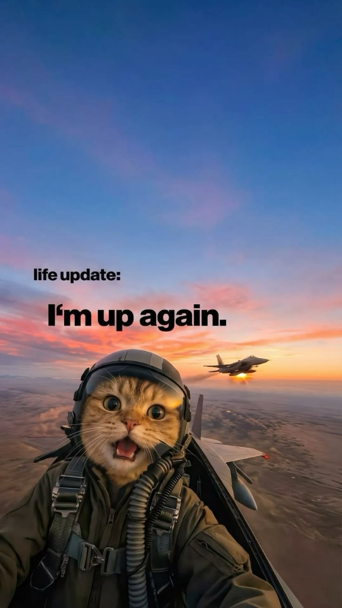
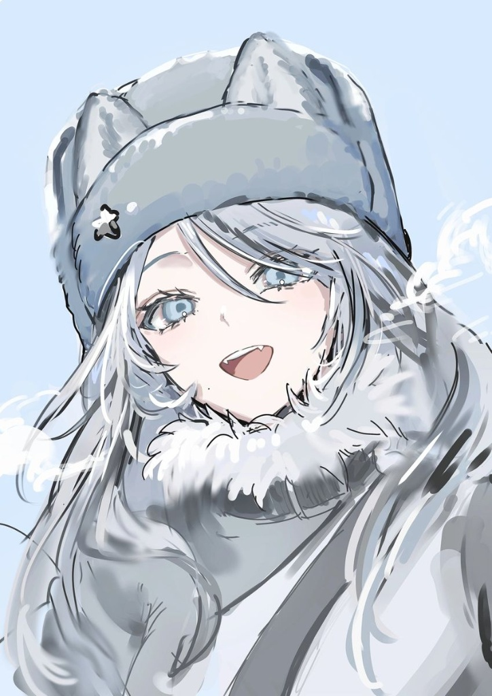

<!-- HERO SECTION: Ảnh Anime Mùa Đông + Giới thiệu -->
<table border="0">
  <tr>
    <td width="35%" align="center" valign="middle">
      
    </td>
    <td width="65%" align="left" valign="middle">
      <h2>Hi, I'm Kov1cx 👋</h2>
      
<i>"Tryna do my best!"</i>

      

        
        
        
      

      
    </td>
  </tr>
</table>

---
## 💬 About Me & Life Update

<table>
  <tr>
    <!-- CỘT TRÁI: THÔNG TIN CHI TIẾT (62%) -->
    <td width="62%" valign="top">
      <!-- Khối 1: Bản thân -->
      <h3>👋 <code>IDENTITY & CURRENT RIG</code></h3>
      <ul>
        <li>🎓 <b>Senior Student</b> majoring in <b>Logistics & Supply Chain Management</b> at <a href="https://huce.edu.vn">HUCE</a>.</li>
        <li>🤖 Researching <b>Data Analytics & Applied AI</b> (Fine-tuning local models for predictive supply chain risk).</li>
        <li>⚡ Running an automated inference & orchestration lab powered by <b>i5-13400F + RTX 3060 12GB</b>.</li>
        <li>🏃‍♂️ Endurance runner targeting <b>Sub-7:00/mile 10K</b>.</li>
      </ul>
       
      <!-- Khối 2: Đang tập trung -->
      <h3>🚀 <code>CURRENT FOCUS & LEARNING</code></h3>
      <ul>
        <li>✨ <b>Cold-Chain Logistics</b> & Reefer Operations (CPT / FOB routes to Japan).</li>
        <li>✨ Automated Risk Ingestion Pipelines utilizing <code>Docker</code> & <code>n8n</code>.</li>
        <li>✨ High-throughput local model serving using <code>vLLM</code> & <code>Ollama</code>.</li>
      </ul>
       
      <!-- Khối 3: Sở thích -->
      <h3>🎮 <code>VIBE & INTERESTS</code></h3>
      <ul>
        <li>🏎️ Sim Racing, F1 & PC building/customizing.</li>
        <li>📚 Film, Light Novels & Alternative Soundtracks.</li>
      </ul>
    </td>
    <!-- CỘT PHẢI: MEME STAY CHILL BRO (38%) -->
    <td width="38%" align="center" valign="middle">
      

        <!-- Thay link bên dưới bằng file ảnh local hoặc link Pinterest của bạn -->
        
        

           "i'm back babe"
        

      

    </td>
  </tr>
</table>

---

---

### 🛠️ Core Stack & Tooling

#### Data Pipelines & Machine Learning

  

#### Systems, Infrastructure & Tooling

  

#### Applied AI & Domain Logistics

  
  
  
  

  
  
  
  

---
### 🏁 Mentality, Hardware & Workspace

<table width="100%">
  <tr>
    <!-- CỘT TRÁI: ẢNH MÈO PHI CÔNG (38%) -->
    <td width="38%" align="center" valign="middle">
      
    </td>
    <!-- CỘT PHẢI: BẢNG CẤU HÌNH & TRIẾT LÝ VẬN HÀNH (62%) -->
    <td width="62%" valign="top" style="padding-left: 15px;">
      <h3 align="left">🖥️ WORKSTATION & INFERENCE RIG</h3>    
      

        
        
        
      

      <table width="100%">
        <tr>
          <td width="32%"><b>⚡ Processor</b></td>
          <td>Intel® Core™ i5-13400F (10C / 16T)</td>
        </tr>
        <tr>
          <td><b>🎮 GPU / VRAM</b></td>
          <td>NVIDIA® GeForce RTX™ 3060 12GB GDDR6</td>
        </tr>
        <tr>
          <td><b>🧠 Memory</b></td>
          <td>16GB High-Speed System Memory</td>
        </tr>
        <tr>
          <td><b>🌐 Networking</b></td>
          <td>ZeroTier Encrypted Mesh SDN</td>
        </tr>
        <tr>
          <td><b>🐳 Runtimes</b></td>
          <td>Ollama • vLLM • Docker Containers • n8n</td>
        </tr>
        <tr>
          <td><b>🎯 Target Pace</b></td>
          <td>Sub-7:00/mile 10K • Low-Latency Automation</td>
        </tr>
      </table>
       
      

        <i>"Zero excuses, pure execution."</i> 
        <code>>> Status: Ascending. Target locked and deploying.</code>
      

    </td>
  </tr>
</table>
---

### 📬 Connect With Me

  
  
  

  

